# AILeatherInspector

**AI-assisted, context-aware quality inspection of automotive leather.**

AILeatherInspector turns leather defect detection into a quality decision that depends on the context and can be traced: each piece gets **PASS**, **REWORK** or **REJECT**, with the reason behind it.

  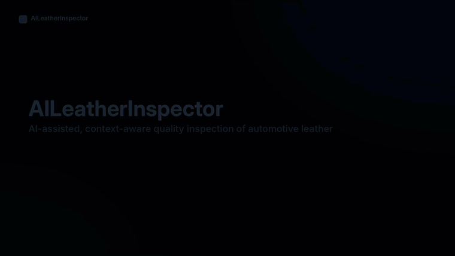

▶️ **Demo video (1 min 43 s):** [`media/AILeatherInspector-demo.mp4`](media/AILeatherInspector-demo.mp4)

> This repository is a **showcase** of a project I built during my internship at **DRÄXLMAIER**. It contains screenshots, a demo video and a description of the project. The source code, the data and the trained models are not published.

---

## The problem

Automotive leather is inspected by eye. The verdict depends on the **customer**, the **leather type**, the **part** and the **inspection zone**: the same mark can be acceptable on a hidden area and unacceptable on a highly visible one.

That makes manual inspection:

- **subjective**: two inspectors can judge the same borderline mark differently;
- **hard to reproduce**: the criteria are complex and applied from experience, under fatigue and changing light;
- **hard to trace**: there is little structured history of what was found, where, how big it was, and why a piece was rejected.

## The idea

I designed and developed **AILeatherInspector**, an AI-assisted inspection system that keeps the inspector in the loop and makes the decision **objective, explainable and traceable**.

The AI does more than say "defect / no defect". It **measures** each defect. Then a **quality rule engine** decides whether that defect is acceptable *for this customer, this leather, this part and this zone*. Every decision is stored, can be explained and corrected by a human, and the corrections are used to improve the models.

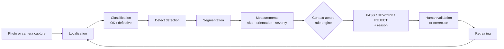

## Features

### Inspection
*Demo: Part 1*

- **Quality context**: the operator chooses the context before the analysis.
- **Image input**: upload a photo or capture the piece with a camera.
- **Step-by-step AI pipeline**: localization, classification, detection and segmentation, each with its confidence. Uncertain cases are flagged for review.
- **Measurements for each wrinkle**: length, width, orientation, area and an **explainable severity score**.
- **Contextual decision**: PASS / REWORK / REJECT with its reason, plus **correction tools** and a **PDF report**.

| | |
|---|---|
| 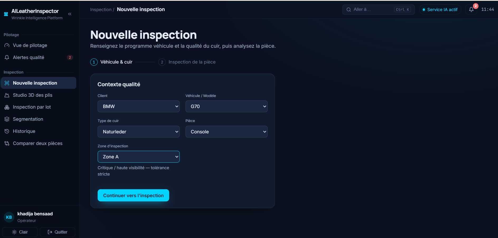 **Quality context** | 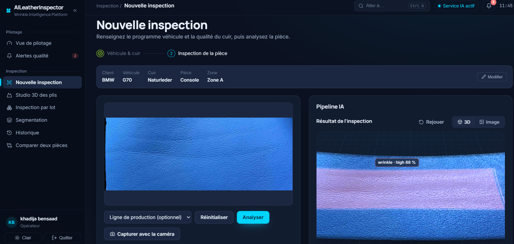 **Result in 3D** |
| 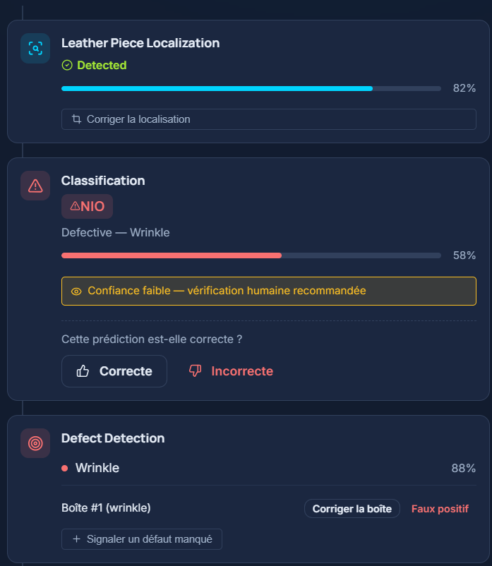 **AI pipeline stages** | 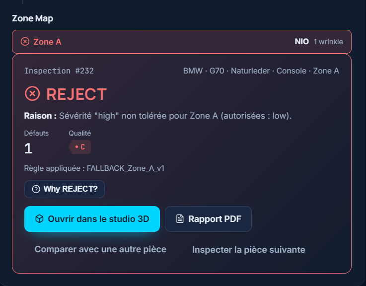 **Decision with its reason** |

### 3D Wrinkle Studio
*Demo: Part 2*

Each inspected piece becomes a **3D surface built from its photo**. The studio offers:

- texture, relief, mesh and severity views;
- a before / after slider;
- a confidence threshold;
- a wrinkle list kept in sync with the image and the 3D view.

| | |
|---|---|
| 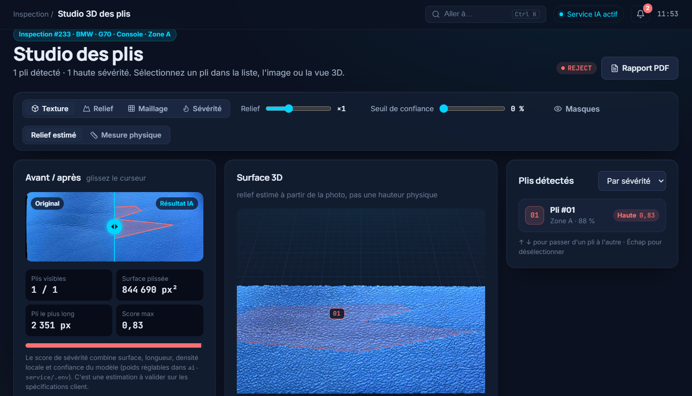 **Studio** | 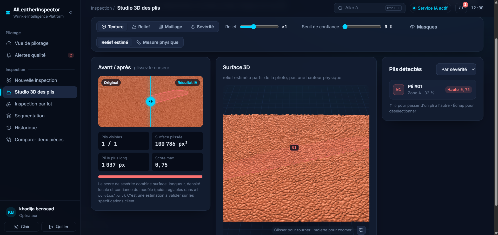 **Estimated relief** |

### Batch inspection and traceability
*Demo: Parts 3 and 4*

- **Batch inspection**: one context, many pieces, processed one by one, with export to Excel.
- **Traceability**:
  - segmentation view;
  - searchable history;
  - PDF reports and Excel export;
  - side-by-side **3D comparison** of two pieces.

| | |
|---|---|
| 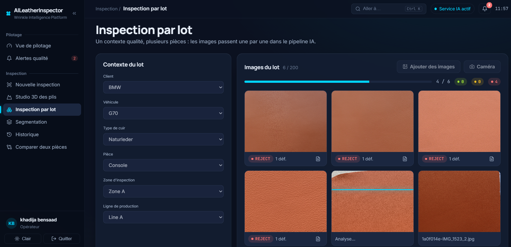 **Batch inspection** | 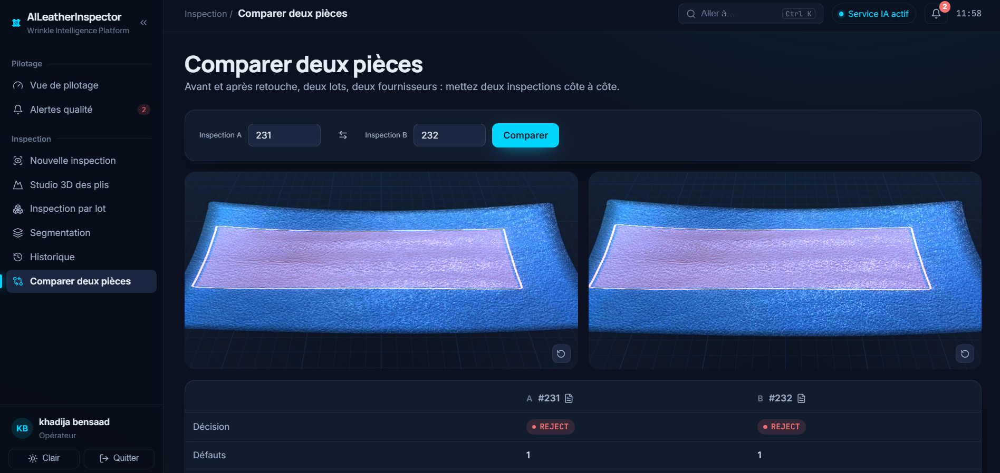 **Compare two pieces** |

### Quality intelligence and continuous improvement
*Demo: Part 5*

- **Dashboards**: KPIs, configurable **alerts**, defect analysis, and a **3D cabin twin** coloured by reject rate.
- **Human-in-the-loop**: corrections are reviewed and exported for retraining.
- **Model monitoring**: confidence and latency.
- **Audit trail** and **role-based access**.

| | |
|---|---|
| 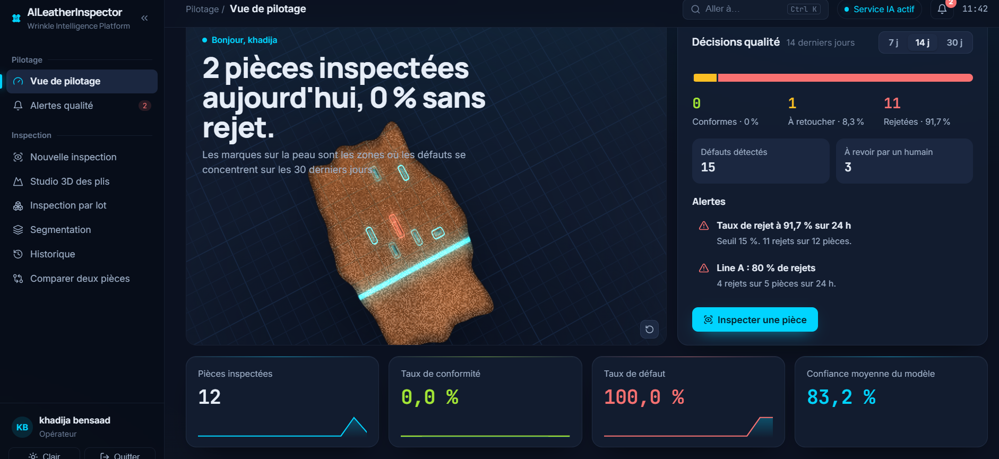 **Dashboard** | 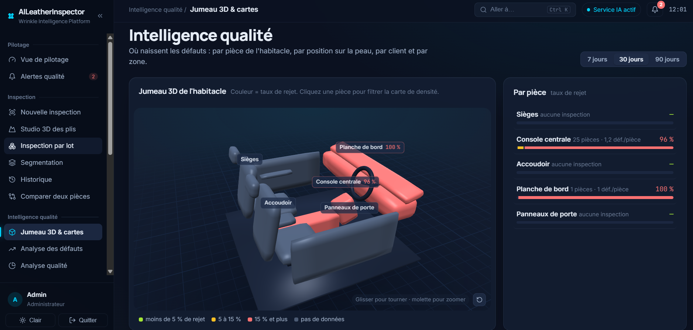 **3D cabin twin** |
| 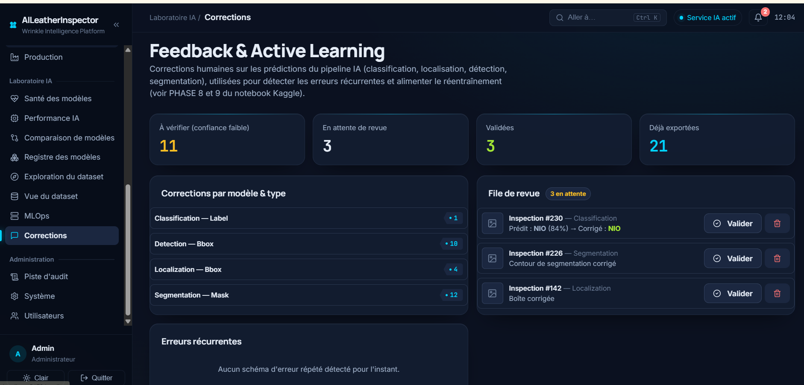 **Corrections & active learning** | 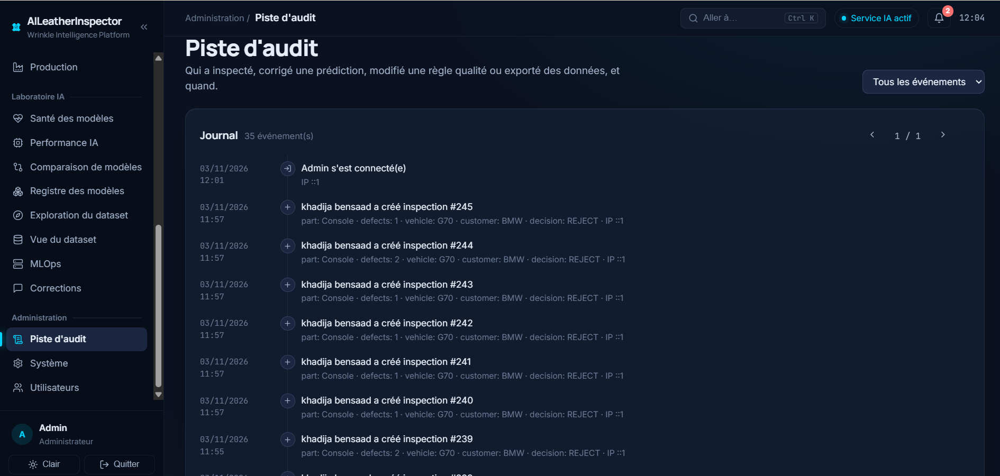 **Audit trail** |

## Architecture and tech stack

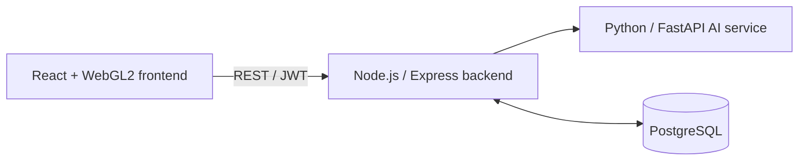

| Layer | Technologies |
|---|---|
| Computer vision | PyTorch, YOLO11-OBB, EfficientNetV2-S, U-Net++, OpenCV |
| AI service | Python, FastAPI |
| Backend | Node.js, Express, JWT, role-based access |
| Database | PostgreSQL |
| Frontend | React, Vite, custom WebGL2 3D engine |
| MLOps | Kaggle notebooks, model monitoring |
| DevOps | Docker, Nginx, GitHub Actions CI/CD |

## Scope

This is a **proof of concept** focused on **wrinkle** defects. The rule engine's thresholds are illustrative examples, and the screenshots and video show test data.

## About

Final-year engineering project (PFA) by **Khadija Bensaad**, engineering student at the Institut Supérieur d'Informatique (ISI), Université de Tunis El Manar, carried out during an internship at **DRÄXLMAIER**, Zaouiet Sousse, Tunisia (2025–2026).
